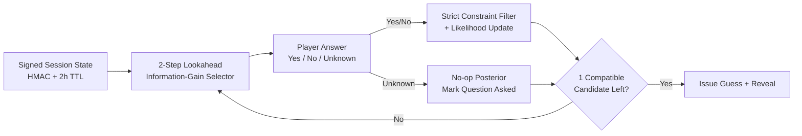

# Deterministic Bayesian Akinator v4

A deterministic animal deduction engine with strict direct-answer consistency, a curated living-animal catalogue (110 targets, 90 tr/en/ar questions), and bounded two-question information-gain lookahead. This standalone mirror shares its canonical seven modules with the portfolio application; it does not include the Next.js transport or UI.

- **Live Demo:** [darrige.tech/projects/ai-akinator](https://darrige.tech/projects/ai-akinator)

## Turn Loop Architecture



## Current Behavior

- **110 catalogue targets** and **90 questions** in English, Turkish, and Arabic.
- **Strict direct-observation compatibility:** A categorical yes/no contradiction permanently removes that candidate. There is no error rescue.
- **Explicit biological uncertainty:** `likely`, `unlikely`, `variable`, `not_applicable`, and missing traits permit both outcomes with calibrated likelihoods where specified.
- **Unknown answers:** Leave the posterior unchanged and consume a question; they cannot be repeated.
- **No turn-time LLM calls:** Optional post-game verification and moderated storage are separate adapters.

## Measured In-Sample Benchmark (`verification/akinator/v4-baseline.json`)

Measured across seeds `[0, 17, 71]` over all 110 catalogue targets (`330` simulated games per scenario):

| Scenario | Success | Mean Questions | p90 Questions | Max Questions |
| :--- | :---: | :---: | :---: | :---: |
| Truthful (0 initial unknowns) | 330 / 330 (100%) | 7.11 | 8 | 11 |
| 2 Initial Unknowns | 330 / 330 (100%) | 9.30 | 10 | 15 |

- **Selector Timing:** `4.96 ms` mean, `15.61 ms` p90 (`27.10 s` total benchmark runtime).

## Run Locally

```bash
npm install
npm run typecheck
npm test
npm run evaluate
npm run evaluate -- --optimize --out verification/akinator/policy-comparison.json
```

Tests mock storage; the evaluator calls only the pure posterior and question selector. Neither needs provider credentials. Use a dedicated server-only `AKINATOR_SESSION_SECRET` of at least 32 characters when exercising signed sessions outside the tests. Optional Upstash storage uses `KV_REST_API_URL` and `KV_REST_API_TOKEN`; absent storage yields the built-in catalogue. Do not configure production credentials for local evaluation.

## Modules

`src/lib/server/` contains `akinator-kb.ts`, `akinator-constraints.ts`, `akinator-scoring.ts`, `akinator-engine.ts`, `db.ts`, `akinator-open-world.ts`, and `akinator-scope.ts`. The two files directly under `src/` are compatibility reexports, not separate engines.

See [architecture](docs/ai-akinator.md), [catalogue provenance](docs/akinator-catalog-provenance.md), and [limitations](docs/ai-akinator-errors-ledger.md).

## Evaluation Boundary

The evaluator uses answers generated from this same catalogue: yes/no for hard traits and unknown for uncertainty. These are reproducible in-sample engineering checks, not independent biological validation, human accuracy, or evidence of out-of-catalogue recognition.

MIT license; see `LICENSE`.
